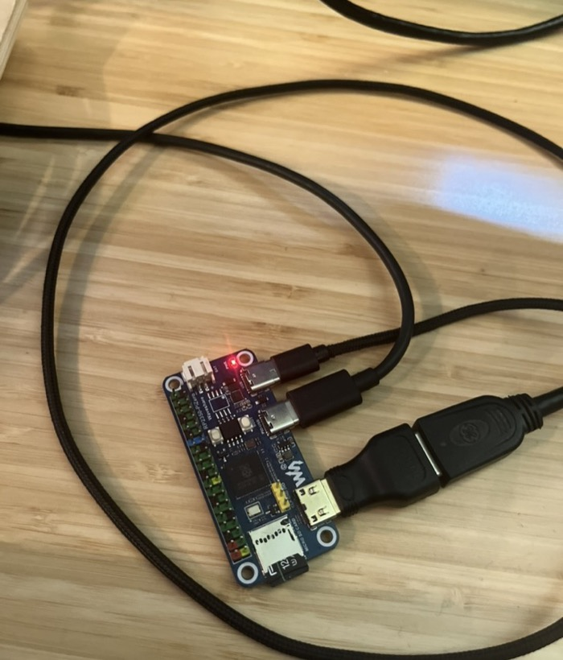
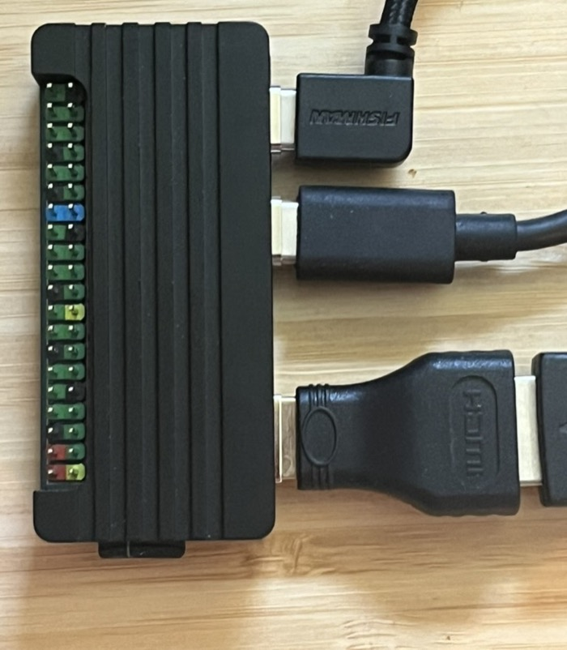

# CoCo Zero

**A Tandy Color Computer emulator on a 65 x 30 mm board.** Plug in a TV, a USB-C keyboard or gamepad,
and a microSD card, and it starts Color BASIC as a CoCo 2, or Super Extended Color BASIC as a
CoCo 3. The picture and the sound both go over one video cable, at 60 frames per second.

It is [XRoar](https://www.6809.org.uk/xroar/), the CoCo emulator, running on a
[Waveshare RP2350-PiZero](https://www.waveshare.com/rp2350-pizero.htm), a microcontroller board the
size of a Raspberry Pi Zero.

<p align="center">
  
</p>

## What it does

**Three machines in one firmware.** The board is the **CoCo Zero**, a CoCo 2 with some extras
(the default); a stock **CoCo 2**; or a stock 128 KB **CoCo 3**. A game's own settings file can say
which it needs, and launching it switches the board to that machine by itself.

**As a CoCo 3:**
- Super Extended Color BASIC at full speed, at 0.89 MHz and at 1.79 MHz (`POKE 65497,0`), with a
  steady picture at both.
- The GIME's modes at full width: 32, 40 and 80-column text and the HSCREEN graphics, with their
  palettes. (HSCREEN 3 and 4, the 640-wide graphics modes, are drawn the same way but not yet
  tried on the board.)
- The CoCo 3's own keys from a USB keyboard: CTRL, ALT, F1 and F2.
- Both buttons of each joystick on a gamepad.
- NitrOS-9 Level 2, from a boot disk the included script builds.

**As a CoCo 2:**
- Color, Extended and Disk BASIC, games and demos, at full speed.
- The high-speed POKEs: `POKE 65495,0` and `POKE 65497,0` run programs up to twice as fast, and
  unlike a real CoCo 2 the screen stays clean.
- A choice of fonts, including true lower case, and the NTSC artifact colours.

**As the CoCo Zero**, the CoCo 2 also has:
- The three-voice sound chip from the Games Master Cartridge, built in.
- The AY-3-8910 sound chips of the CoCo PSG and Symphony-12 cartridges, built in: up to four
  chips and twelve voices, the Symphony-12's in stereo.
- The two stereo DACs of Tandy's Orchestra-90CC, built in. How to program each sound chip, and
  what it costs: [`docs/sound.md`](docs/sound.md).
- Every sound source at once, the DAC and the sound cartridges together, where the real CoCo
  switched between them, and joystick reads that make no sound.
- Sound from a USB headphone DAC plugged in at power-on, in place of the video cable, and the
  volume on the keyboard's volume keys ([`docs/sound.md`](docs/sound.md)).
- The CoCo 3's palette registers and timer.
- True lower case on screen, in the 6847T2 font.
- Auto-repeat for a key held down, which Color BASIC never did.

**On every machine:**
- Picture and sound over one video cable, at 60 frames per second.
- On-screen lists to pick disks, programs and cartridges.
- A USB-C keyboard where each key types what is printed on it, and a USB-C gamepad that works as
  both joysticks and can pick and start games.
- Settings in text files, for all games or just one.
- Print Screen saves a screenshot to the card.
- A game can start by itself at power-on.
- A printable case shaped like a CoCo 2.

## What you need

- A **Waveshare RP2350-PiZero** board ([product page](https://www.waveshare.com/rp2350-pizero.htm)).
  It has two USB-C ports and one mini video port (the same small video connector as a Raspberry Pi Zero). One USB-C port is for power, and for installing the
  firmware. The other USB-C port is for your keyboard and gamepad.
- A **TV or computer monitor** with a digital video input, and a **mini video cable or adapter** to
  reach it (the kind sold for the Raspberry Pi Zero).
- A **USB-C power supply**, such as a phone charger.
- A **USB-C keyboard**, a **USB-C gamepad**, or both.
  - A keyboard or gamepad with the older, rectangular USB-A plug works too, with a small USB-C to
    USB-A adapter.
  - To use a keyboard and a gamepad at the same time, plug them into a simple **USB-C hub**. Some
    larger hubs, with several hub chips inside, do not work yet.
  - The keyboard and gamepad port runs at USB 1.1 speed (full speed). Ordinary keyboards, wireless
    receivers and most gamepads work. A device that only works at high speed does not.
- A **microSD card**, formatted FAT32, with the CoCo ROM files on it. You supply the ROMs (see
  below). The CoCo 2 needs `bas12.rom`; the CoCo 3 needs `coco3.rom`. Disks need `disk11.rom` on
  either machine.
- A computer with [PlatformIO](https://platformio.org/install) and a **USB-C cable**, to install the
  firmware.
- *Optional:* the printable [case](hardware/case/README.md).

> **ROMs are not included.** Color, Extended, Disk and Super Extended Color BASIC are © Microsoft,
> Tandy and Microware and may not be redistributed. Use dumps from hardware you own.

<p align="center">
  
  <br>
  <em>The two USB-C ports (keyboard and gamepad, and power) and the mini video adapter.</em>
</p>

## Quick start

1. **Install the firmware.** Connect the board's USB-C power port to your computer and run
   `pio run -t upload`. If the upload can't reset the board, hold the **BOOT** button while you
   plug in the USB-C cable.
2. **Fill the microSD card.**
   - Put the ROMs in the folder `/coco/roms/`. For the CoCo 2: `bas12.rom`, and if you have them,
     `extbas11.rom` and `disk11.rom`. For the CoCo 3: `coco3.rom` (32 KB), and `disk11.rom` for
     disks.
   - Put disks (`.dsk` files) in `/coco/dsk`, programs (`.bin` files) in `/coco/bin`, and cartridges
     (`.ccc` files) in `/coco/cart`.
3. **Connect everything and switch on.**
   - Plug the TV or monitor into the mini video port.
   - Plug the keyboard or gamepad (or the hub) into the USB-C keyboard port.
   - Push the microSD card into its slot.
   - Last, plug USB-C power into the power port.

   The CoCo 2's `OK` prompt appears after a few seconds. If the card or a ROM is missing, the
   screen tells you what to copy, and where.
4. **Play a game.** Press **F12** for disks, **F9** for programs, or **F10** for cartridges. On a
   gamepad, press **Home**. Highlight a game, then press **ENTER** (or **A** on the gamepad).

To start a game automatically when the board boots, see [`AUTORUN.md`](AUTORUN.md). Every setting is
explained in [`SETTINGS.md`](SETTINGS.md).

## Choosing the machine

The board starts as the machine `settings.txt` names:

| `machine =` | What you get |
|---|---|
| `cocozero` (the default) | A CoCo 2 with the extras above: the sound chips, the CoCo 3 palette and timer, true lower case, auto-repeat. |
| `coco2` | A stock CoCo 2, as Tandy shipped it: no extras, the original font, no auto-repeat. |
| `coco3` | A stock 128 KB CoCo 3, no auto-repeat. |

The machine only sets the starting point for those extras. Any of them can still be turned on or
off on its own in `settings.txt` or a game's file (see [`SETTINGS.md`](SETTINGS.md)), and a Games
Master Cartridge brings its sound chip on any machine. Change the machine on the board with
**F11**, `SETTINGS.TXT`, and Ctrl-S. Between the CoCo 2s it changes straight away; to or from the
CoCo 3 the board restarts.

The easier way is to mark the CoCo 3 games. In the list, highlight a CoCo 3 game, press **TAB** to
make its own settings file, add the line `machine = coco3` and save. That file sits next to the
game, `STARCAST.TXT` beside `STARCAST.DSK`:

```
# /coco/dsk/STARCAST.TXT
machine = coco3
```

From then on, launching that game restarts the board as a CoCo 3, which takes about two seconds,
and starts it. Launching a game without that line goes back to the machine `settings.txt` names,
the same way. RUN and power-on always start that machine. Without `coco3.rom` on the card, a page
says so and the board stays a CoCo 2.

The CoCo 3 is the 128 KB model. Software that needs 512 KB does not run: a program that checks says
so, and one that does not crashes or hangs, as it would on a real 128 KB CoCo 3. As sold, the board
has no room for more memory. What has been tried, title by title: [`docs/coco3-titles.md`](docs/coco3-titles.md).
The board does have an empty spot for a PSRAM memory chip, and a 512 KB CoCo 3 on boards with it
fitted is the plan; see [`docs/coco-zero-2-proposal.md`](docs/coco-zero-2-proposal.md).

## Controls

| To | Keyboard | Gamepad |
|---|---|---|
| Open the lists | **F12** disks, **F9** programs, **F10** cartridges, **F11** files; the INFO page is one more, Left of disks | **Home** |
| Move, switch list | arrows, PgUp/PgDn, Home/End | D-pad, L1/R1 |
| Start the highlighted game | **ENTER** | **A** |
| Go back, close | **ESC** (or the list's own F key) | **B** (or Home) |
| Edit that game's settings | **TAB** | **X** |
| Edit a text file: **F11** lists `SETTINGS.TXT`, `AUTORUN.TXT` and `DRIVES.TXT` (read-only: the board rewrites it on every mount), then every text file in `/coco` itself (a `README.md`, a `LICENSE`, ASCII BASIC), then the ASCII files on each disk in a drive, named as Disk BASIC names them (`README.TXT:1`). Files on a disk open read-only. A game's own settings file is still **TAB** in its list. Files over 4 KB are listed but not opened, and the bottom row says why. A file keeps its own line endings when saved (CR, LF or CRLF), and a new one is written with the CoCo's CR | **ENTER** in **F11** | |
| Put a disk in drive 0 to 3 | **0** to **3** | |
| Lock the highlighted disk's drive read-only (and unlock it) | **W** | |
| Make a new blank, formatted disk: type its name, then Enter | **N** | |
| Rename the highlighted disk | **R** | |
| Save a screenshot | **Print Screen** | **M** (GameSir pads) |
| Change the artifact colors (on, swapped, off), saved for the running game (CoCo 2) | **F8** | |
| Volume up and down (0 to 15, saved), mute | the keyboard's **Volume Up**, **Volume Down** and **Mute** keys | |

**In BASIC:** Caps Lock switches upper and lower case, Home is CLEAR, Esc is BREAK, and Backspace
deletes. The CoCo's keyboard has no way to type `{ } | ~` or a backtick, so those keys do
nothing. The screen can still show them: `PRINT CHR$(123)` prints `{` with the default 6847t2 font.
On the CoCo 3, Ctrl, Alt, F1 and F2 are its own CTRL, ALT, F1 and F2 keys. On the CoCo 2 they
do nothing, since it has no such keys.

**In a game, on the gamepad:** the left stick (or D-pad) is the right joystick, the one nearly all
software reads, and the right stick is the left joystick. A, B and R1 fire the right joystick; X
and L1 fire the left one. On the CoCo 3, R2 and L2 are those joysticks' second buttons. Start is
ENTER and the top button is SPACE. Every button can be remapped,
per game too (`pad_start = s`, `dpad = arrows`).

**On the board:** RUN restarts to the BASIC prompt, skipping autorun (see `reset_button`). BOOT is only for flashing.

**The INFO page** (F12, then Left) shows the firmware version, the chip, the board's serial number, the clock, uptime, free
memory and USB devices.

## Status

Everything above works on hardware.

**The CoCo 3**, checked on the board: Super Extended Color BASIC at 60 fps at 0.89 and 1.79 MHz,
with sound; WIDTH 40 and WIDTH 80 text; the palette, the GIME timer and the HSCREEN modes
(PIZERO-214, 134); CTRL, ALT, F1, F2 and the second fire buttons (PIZERO-215); Space Raid,
Starcast and Galactus play (PIZERO-228); NitrOS-9 Level 2 boots to its shell (PIZERO-236).
Its limits:

- **128 KB only.** 512 KB software does not run, and cannot on this board (see above).
- **Less free memory.** A CoCo 3 leaves about 17 KB free, so a bank-switched cartridge (32 KB and
  up) does not fit while the board is a CoCo 3.
- **Slower screenshots.** A screenshot is 640x480 and pauses the machine for about a second
  (PIZERO-237).

**Known gaps on every machine:**

- **Plugging in while it is on:** a keyboard or gamepad plugged straight into the board must be
  there when you switch on. Through a USB-C hub, one plugged in later can work (PIZERO-51).
- **Larger USB-C hubs** with several hub chips inside don't work yet. A simple hub does
  (PIZERO-159).
- **Gamepads:** tested with a GameSir Tegenaria Lite in its Android and automatic modes. Its
  Switch mode sends nothing (PIZERO-157).
- **Disk writes are new** (PIZERO-66): `SAVE`, `SAVEM`, `KILL` and the rest write straight into the
  `.DSK` on the card. Press **W** in the disk list to lock a drive read-only. A `.DSK` whose file is
  read-only on the card is always locked.
- **The CoCo 2's high-speed POKEs** (PIZERO-132): `POKE 65495,0` (address-dependent) and
  `POKE 65497,0` (full, 2×) work, `POKE 65494,0` and `POKE 65496,0` go back to normal, and a reset
  always does. Details and measurements in [`docs/cpu-speed.md`](docs/cpu-speed.md).

**NitrOS-9 notes.** Level 1 runs on the CoCo 2, Level 2 on the CoCo 3. A NitrOS-9 boot disk boots
with `DOS` (PIZERO-191) and its files can be written (PIZERO-66). Things that look like firmware
faults but are not:

- **Case:** OS-9's console driver starts in upper case and toggles case on CTRL-0, where CTRL is the
  CoCo's CLEAR key, so press **Home+0** on the USB keyboard. Shift+letter gives the other case
  without toggling. The Caps Lock key sends Color BASIC's toggle (Shift+0), which OS-9 reads as a
  zero (PIZERO-197 will make it configurable).
- **Device names:** the disk is whatever descriptor its boot file carries. A game disk may have
  only `/dd`, so `/d0/...` fails with `ERROR #221` (the kernel looks for a `D0` module).
- **Missing commands:** `dir`, `list` or `build` on a game disk give `ERROR #216` because they are
  not in its CMDS.
- **A working disk:** `scripts/mkos9disk.py` builds a NitrOS-9 Level 1 boot floppy the board can
  use (35 tracks, one side) from a NitrOS-9 6809 Level 1 distribution image, such as
  `NITROS9/nos9l1.dsk` on the CoCo SDC image: `/d0`, `/d1`, `/d2` and `/dd`, pipes, and 66 of the
  distribution's commands, with about 52 KB free. Boot it with `DOS`; its startup asks for the date
  and time. Put a game disk in drive 1 and it is `/d1` (PIZERO-199).
- **Level 2, for the CoCo 3:** `scripts/mkos9disk.py --level 2` builds a NitrOS-9 Level 2 boot
  floppy the same way from a Level 2 image, such as `NITROS9/nos9l2.dsk` on the CoCo SDC image.
  It boots on the CoCo 3 to an 80-column shell, with 77 commands and about 11 KB free
  (PIZERO-236). Give its disk a settings file with `machine = coco3` and it switches the board by
  itself. Give it a name that isn't already on the card: the card ignores case, so
  `NOS9L2.DSK` would replace `nos9l2.dsk`. The distribution images themselves don't boot on the
  board: they're made for CoCo SDC hardware.
- **`dir` into a file or pipe** drops most names, because it lays out columns for a screen it
  cannot measure. `dir -e` lists one file a line and redirects cleanly.

**Soaking without a laptop.** `soak_log = on` in `settings.txt` makes the board write its own
telemetry to `/coco/log/` once a minute, timestamped, so a long run needs only a power supply
(PIZERO-201; recipe in docs/BUILD.md).

**Stability, measured (`PIZERO-98`, 2026-09-17/18).** A soak of the default build logged 13 h of
wall clock, about 7.5 h of it observed (the host slept through the rest). Video: 0.38 short sync
windows an hour and no second-long dropouts, against the Fruit Jam port's 7.6 dropouts an hour.
Freezes: about 0.46 an hour, all in the emulation phase, every one recovered by the watchdog
(`PIZERO-33`). **Without a laptop (`PIZERO-168`, 2026-10-09/10).** The first soak logged to the card
(`soak_log`), on the product build of 2026-10-09, powered from a monitor's USB-C port: 26.7 h
observed across four boots. Video: 0.67 short windows an hour (0.39 in the first 22.8 h, against
PIZERO-98's 0.38). Freezes: none in the first 22.8 h; then an unexplained power-on, and two
watchdog recoveries in the next four hours, both at the end of the frame rather than in the
emulation, so a different place from PIZERO-98's (`PIZERO-203`).

How USB input got here, and the lessons along the way: [`docs/usb-retrospective.md`](docs/usb-retrospective.md).
The two days before Tandy Assembly, and their lessons: [`docs/show-prep-retrospective.md`](docs/show-prep-retrospective.md).
How the CoCo 3 got here, and its lessons: [`docs/coco3-retrospective.md`](docs/coco3-retrospective.md).
Open work is in `issues.jsonl` (use `/issues`), sequenced in [`docs/ROADMAP.md`](docs/ROADMAP.md).
Where the hardware is going: a factory-fitted PSRAM board for a 512 KB CoCo 3, then a board of our
own ([`docs/coco-zero-2-proposal.md`](docs/coco-zero-2-proposal.md)), and how to work with the
board's maker ([`docs/supplier-primer.md`](docs/supplier-primer.md)).

<details>
<summary>Development phases</summary>

| Phase | Goal | Issues | Status |
|---|---|---|---|
| 0 | Decisions + scaffolding | PIZERO-01..03 | ✅ done |
| 1 | Video bring-up: DVI test pattern | PIZERO-04..05 | ✅ done |
| 2 | XRoar boots to Color BASIC "OK" on screen | PIZERO-06..09 | ✅ done |
| 3 | Autonomous self-running demo | PIZERO-10 | ✅ done |
| 4 | USB-host keyboard / joystick input | PIZERO-11/11a/11b/12/13/54 | 🟡 keyboard, gamepad and hub done; hot-replug open |
| 5 | Dual-core split + performance | PIZERO-14..15 | ✅ done |
| 6 | Sound over the video cable (CoCo 6-bit DAC, and the SN76489) | PIZERO-18, 26–35, 38/39, 143 | ✅ done: streaming per-active-line delivery (warble fixed) |
| 7 | Clean audio + stability | PIZERO-33 (watchdog), PIZERO-35/38 (delivery re-arch) | ✅ done |
| 8 | True in-spec 640×480p60 + audio + USB at 252 MHz | PIZERO-44/45 | ✅ done: now the default build |
| 9 | A 128 KB CoCo 3 at full speed, 640 wide, in the same firmware | PIZERO-129..135, 213..236 | ✅ done |

</details>

# How it works

The rest of this README is for people who want to know how it is built.

## Target hardware

The RP2350-PiZero is a Raspberry Pi Zero form-factor board built around the **RP2350B**:

- **MCU**: RP2350B (dual Cortex-M33 / dual Hazard3 RISC-V), 48 GPIO, 150 MHz stock (overclockable).
- **Memory**: 520 KB on-chip SRAM, 16 MB flash. A PSRAM footprint (U1, chip select on GPIO 47) exists on the PCB but is **not populated**, so the firmware is SRAM-only. Fitting it is the route to a 512 KB CoCo 3 ([`docs/coco-zero-2-proposal.md`](docs/coco-zero-2-proposal.md)).
- **Display**: mini video connector carrying a DVI signal, driven from GPIO via PIO (see below).
- **Input**: a dedicated PIO-USB Type-C port usable as a USB 1.1 host (a second Type-C is power/programming).
- **Storage**: microSD slot on SPI.

### Pinout (confirmed against the Waveshare schematic and demo source)

| Function | GPIO | Notes |
|---|---|---|
| DVI TMDS data 2 (±) | 32 / 33 | DVI driven by PIO `libdvi` |
| DVI TMDS data 1 (±) | 34 / 35 | |
| DVI TMDS data 0 (±) | 36 / 37 | |
| DVI TMDS clock (±) | 38 / 39 | |
| Display DDC / CEC | 44 + others | not needed for video output |
| microSD SCK | 30 | SPI, ~12.5 MHz |
| microSD MOSI | 31 | |
| microSD MISO | 40 | |
| microSD CS | 43 | software chip-select |
| microSD card-detect | 22 | |
| USB host D+ / D− | 28 / 29 | PIO-USB; D− is always D+ +1 |
| I²C0 SDA / SCL | 6 / 7 | |
| UART0 TX / RX | 0 / 1 | |
| WS2812 status LED | 2 | |

The reference DVI configuration is the upstream `pico_sock_cfg` (`invert_diffpairs = false`,
`pio_set_gpio_base(pio, 16)` because the TMDS pins are above GPIO 31).

## How the video output works

The mini video connector is wired **directly to RP2350 GPIOs** through series resistors; there is no
video transmitter chip. DVI carries video as four TMDS differential pairs (clock + 3 data lanes = 8
wires), and each pair is produced by two adjacent GPIOs driven in opposite polarity.

The RP2350 has two ways to generate that high-speed TMDS bitstream:

- **PIO `libdvi`** (Wren6991/PicoDVI): PIO state machines + DMA do the TMDS encoding in software.
- **HSTX**: a dedicated hardware serializer, but it is hardwired to **GPIO 12–19 only**.

On this board the video connector is on **GPIO 32–39**, so **HSTX cannot drive it**; `libdvi` (PIO) is
the only option. This matches Waveshare's own reference demos, which use `libdvi` on this board.

For the full end-to-end signal path (emulated CoCo screen and sound all the way to the connector pins,
including how audio rides inside the TMDS stream as data islands), see
[`docs/pipeline.md`](docs/pipeline.md).

### Display geometry

A literal 640×480 RGB565 framebuffer would be ~614 KB and does not fit in 520 KB SRAM beside the
CoCo's RAM. Instead the framebuffer is **640×240 at one byte a pixel (153,600 bytes)**: each byte
is a colour number, which core 1 looks up in a 256-entry palette as it encodes each line on the
RP2350's hardware TMDS encoder, and `libdvi` shows each line twice, for **640×480p 60 Hz**
(`DVI_VERTICAL_REPEAT = 2`; PIZERO-134).

- **As a CoCo 3**, the GIME's 640 pixels a line land one for one, so the 640-wide modes and
  80-column text show whole, and a 320-wide mode is each pixel twice.
- **As a CoCo 2**, the VDG's 256×192 is drawn each pixel twice, centred with a border, and appears
  on the monitor as **512×384**.

## System-clock reconciliation (video + USB host): resolved

DVI and PIO-USB want different system clocks: DVI's TMDS bit clock prefers ~252 MHz for
640×480p60 (25.175 MHz pixel), while Pico-PIO-USB asserts the CPU is *exactly* 120 MHz or
240 MHz. The original bring-up (`PIZERO-02b`) sidestepped this by running at **240 MHz** with an
off-spec 24 MHz pixel clock (~52–57 Hz refresh). **`PIZERO-44`/`PIZERO-45` resolved it properly:
at 252 MHz the PIO-USB clock dividers come out *exact* (252/48 = 5.25), so USB and a standard
25.2 MHz pixel clock coexist.** The default build now runs **252 MHz → 25.2 MHz pixel, 800×525 =
true 60.0 Hz**: standard, monitor-friendly 640×480p60 with correct game speed and USB host all at
once. The emulator is paced from `FRAME_PERIOD_US` (16.67 ms) to match. (The old 240 MHz/~52 Hz
timing is kept only as a fallback env, without the CoCo 3-style palette and timer; see
[`docs/BUILD.md`](docs/BUILD.md).)

## Software architecture

```
┌──────────────────────────────────────────────────────────┐
│  core 0  emulation + VDG or GIME render + USB + SD        │
│  core 1  DVI scanout (libdvi, palette) + audio encode     │
├──────────────────────────────────────────────────────────┤
│  lib/coco_machine   CoCo bus glue + minimal FDC  (reused) │
│  lib/xroar_core     vendored XRoar core          (reused) │
├──────────────────────────────────────────────────────────┤
│  libdvi             PIO DVI driver (Wren6991/PicoDVI)     │
│  Pico-PIO-USB + Adafruit TinyUSB   USB host              │
│  no-OS-FatFS-SD     microSD over SPI                     │
└──────────────────────────────────────────────────────────┘
```

The XRoar core (`lib/xroar_core`) and the CoCo glue (`lib/coco_machine`) are board-agnostic. They
started as the AMOLED port's, and have since grown the CoCo 3 (the GIME as the bus, the MMU fast
path), the faster 6809 core and the extra joystick buttons. Everything below the line (DVI, USB, SD)
is board-specific and built on Waveshare's proven reference stack for this board (earlephilhower
arduino-pico core).

## Building from source

PlatformIO with the earlephilhower arduino-pico core, targeting the RP2350B.
**See [`docs/BUILD.md`](docs/BUILD.md)** for the full env + build-flag matrix and
toolchain gotchas. In short:

```
pio run                 -t upload   # DEFAULT: true 640x480p60 + audio + USB
pio run -e pizero_stream -t upload  # fallback: older ~52 Hz timing, for a picky display
pio device monitor                  # serial @ 115200: prints per-second [run] fps/cpu/blit
```

A bare `pio run` builds the default `pizero_stream_60` env (60 Hz, streaming
audio, USB host). The off-spec 52 Hz `pizero_stream` is kept as the fallback for
displays that reject 60 Hz. Don't enable flags via the `PLATFORMIO_BUILD_FLAGS` env var: it links
stale objects (see BUILD.md §4b).

A microSD card is required, with the CoCo ROMs in **`/coco/roms/`**: `bas12.rom` for the CoCo 2
(and optionally `extbas11.rom`), `coco3.rom` for the CoCo 3, and the `disk11.rom` cartridge for
disks on either, plus optional disks, programs, cartridges, `settings.txt` and `autorun.txt` (see
[`AUTORUN.md`](AUTORUN.md)).

## Performance

The headline result: **both machines run at a locked 60 fps**, full real-time, on a 252 MHz system
clock driving standard 640×480p60, with about a fifth of the core-0 frame budget still free even
with USB-host servicing (keyboard and gamepad) running on core 0.

Per-frame work on core 0, against the 60 Hz frame period of **16.67 ms** (from the `[run]`
telemetry of the default build at the BASIC prompt, 2026-10-13):

| Work | Time | Notes |
|---|---|---|
| CoCo emulation | ~6.2 ms | ~14,900 6809 cycles/frame at the emulated ~0.895 MHz; was ~11 ms before the faster core (PIZERO-131) |
| `render_frame` (alpha/text) | ~0.5 ms | precomputed glyph-row → packed-word LUT |
| Blit and the rest of the loop | ~2.4 ms | the blit into the 640-wide framebuffer (~0.9 ms), USB host, audio |
| **Total** | **~9 ms** | at least 7.6 ms (about 45%) to spare in the tightest frame |

As a CoCo 3 it runs about twice the cycles at 1.79 MHz and draws each scanline
as it goes, with no separate render or blit: about 13 ms a frame at the BASIC prompt and at most
15.2 ms in a full-screen animation (PIZERO-220).

How we got from the first boot (54 fps) to a locked 60 fps:

- **Paint the static border once** at init instead of re-clearing it every frame, saving ~27K
  redundant pixel writes per frame (`src/coco_boot.cpp`).
- **Glyph-row → packed-32-bit-word render LUT** for alpha (text) mode, replacing per-pixel
  read-modify-write: **~6.4 ms → ~0.56 ms** per frame. (Graphics modes still use the per-pixel path.)
- **Double buffering** (`PIZERO-14`): two 320×240 RGB565 buffers with a `volatile` front-buffer
  handoff from core 0 to core 1, so `libdvi` never samples a half-rendered frame. Costs **96.8% RAM**
  (507,340 / 524,288 bytes) in the double-buffered envs `pizero` and `pizero_60hz`, since retired
  (PIZERO-150). The default
  `pizero_stream_60` **single**-buffers instead (the audio data islands need the framebuffer's
  ~150 KB) and sits at **81.2%** of RAM, both machines included (PIZERO-135, 2026-10-20). The
  CoCo 2's 24 KB render buffer and the CoCo 3's second 64 KB come from the heap, so only the
  machine running takes its share: free heap with the machine running is about 59 KB as a CoCo 2
  and 17 KB as a CoCo 3.

Performance instrumentation, clock, and vreg tuning landed in `PIZERO-15`; the serial monitor prints
per-second `[run]` fps/cpu/blit stats. For comparison, the AMOLED port manages ~15 fps (~36%
real-time), so this is roughly a **4× improvement**.

The CoCo's **high-speed POKEs** (SAM double speed) fit the frame (`PIZERO-132`): at `POKE 65497,0`
(full, 2×) emulation takes about 12.6 ms a frame and at `POKE 65495,0` about 12.4 ms in BASIC,
with no late frames and no audio shortfall. Normal speed is the 6.2 ms above. See
[`docs/cpu-speed.md`](docs/cpu-speed.md).

Note the two distinct clocks: the host RP2350 MCU runs at **252 MHz** (set from the DVI TMDS bit
clock), while the *emulated* 6809 runs at its authentic **~0.895 MHz**, independent of the host clock.

## Case

A two-part 3D-printed case lives in [`hardware/case/`](hardware/case/README.md),
styled after the ventilated top of a Tandy Color Computer 2. It is 69.8 x 34.8 x
18.6 mm, prints without supports, and closes with four M2.5 screws that pass
through the board's own mounting holes so one set of fasteners both clamps the
board and shuts the case. Openings for the mini video port, both USB-C ports, the microSD
slot and the battery connector, with the RUN and BOOT buttons reachable through
the vent slots.

The source is a single parametric OpenSCAD file, so every dimension is a named
parameter and the STLs are rendered from it rather than drawn. The board
geometry was scaled off Waveshare's published dimension drawing rather than
measured by hand. [`hardware/case/README.md`](hardware/case/README.md) has the
full account, including what had to be changed after each test print and the one
detail that turned out not to be printable.

Note that a stock Raspberry Pi Zero shell fits the outline and mounting holes but
**not the ports**: this board uses two USB-C where a Pi Zero has micro-USB, in
different positions, and adds a battery connector and a debug header.

## References

- Waveshare RP2350-PiZero wiki: https://www.waveshare.com/wiki/RP2350-PiZero (board schematic mirrored at `docs/RP2350-PiZero-schematic.pdf`)
- USB-host reference: [ugufru/waveshare-rp2350-usb-a](https://github.com/ugufru/waveshare-rp2350-usb-a)
- Upstream DVI driver: [Wren6991/PicoDVI](https://github.com/Wren6991/PicoDVI)
- USB host stack: [sekigon-gonnoc/Pico-PIO-USB](https://github.com/sekigon-gonnoc/Pico-PIO-USB) + Adafruit TinyUSB
