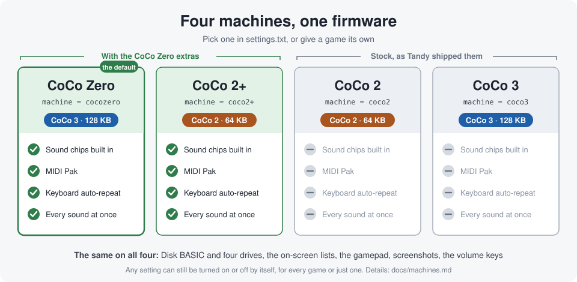

# The four machines

One firmware, four machines. `machine =` in `/coco/settings.txt` picks the one the board starts
as, and a game's own settings file (`MYGAME.TXT` beside `MYGAME.DSK`) can ask for another
(PIZERO-135, 242, 280). The README's [Choosing the machine](../README.md#choosing-the-machine)
says how to switch; this page says what each one is.

<p align="center">
  
</p>

## In short

- **Two CoCo 3s and two CoCo 2s.** `cocozero` and `coco3` are a 128 KB Color Computer 3;
  `coco2+` and `coco2` are a Color Computer 2.
- **Two with the extras, two stock.** The CoCo Zero and the CoCo 2+ turn on this project's
  improvements: the built-in sound cartridges, the MIDI Pak, auto-repeat and the rest. The stock
  CoCo 2 and CoCo 3 are as Tandy shipped them, for software that minds.
- **The default is the CoCo Zero.** Without `coco3.rom` on the card it runs as a CoCo 2+ instead.

## Side by side

| | `cocozero` (default) | `coco2+` | `coco2` | `coco3` |
|---|---|---|---|---|
| The machine | CoCo 3, 128 KB | CoCo 2, 64 KB | CoCo 2, 64 KB | CoCo 3, 128 KB |
| ROMs in `/coco/roms/` | `coco3.rom` | `bas12.rom` (and `extbas11.rom`) | `bas12.rom` (and `extbas11.rom`) | `coco3.rom` |
| BASIC | Super Extended Color BASIC | Color and Extended BASIC | Color and Extended BASIC | Super Extended Color BASIC |
| **Sound** | | | | |
| SN76489 (Games Master Cartridge) | on | on | off\* | off\* |
| AY chips: CoCo PSG and Symphony-12 | on | on | off | off |
| Orchestra-90CC | on | on | off | off |
| Every sound source at once | yes | yes | no: switched, as the real machine | no: switched |
| Joystick reads kept out of the sound | yes | yes | no | no |
| **MIDI Pak** | on | on | off | off |
| **Keyboard auto-repeat** | on | on | off | off |
| **Screen** | | | | |
| Font | the CoCo 3's own | 6847T2, true lower case | classic (lower case as inverse capitals) | the CoCo 3's own |
| CoCo 3-style palette and timer | the GIME's own | on | off | the GIME's own |
| Artifact colours (PMODE 4) | n/a | on | on | n/a |
| **Software** | | | | |
| Bank-switched cartridges (32 KB and up) | do not fit | yes | yes | do not fit |
| NitrOS-9 | Level 2 | Level 1 | Level 1 | Level 2 |

\* A Games Master Cartridge image brings its SN76489 on any machine.

Disk BASIC (`disk11.rom`), the four drives, the on-screen lists, the gamepad, screenshots, USB
audio, the volume keys and autorun are the same on all four.

## How it works

The machine is only a **starting point** (`settings_profile`, `src/settings.h:139`). The two plus
machines turn on one list of settings, and the two stock machines leave all of them off:

```
sn76489  coco_psg  symphony12  orchestra90  midi_pak
sound_sources = all  joystick_quiet  key_repeat
gime_palette  gime_timer  font = 6847t2  lowercase      (these four change the CoCo 2 only)
```

Then `settings.txt`, then the game's own file, go on top, so any line still wins on any machine:
`midi_pak = on` in a program's file gives a stock CoCo 3 the MIDI Pak, and `key_repeat = off`
takes auto-repeat away from one game on the CoCo Zero. Every setting is in
[`SETTINGS.md`](../SETTINGS.md); the sound chips are in [`sound.md`](sound.md).

## Switching

- **Within a pair** (`cocozero` and `coco3`, or `coco2+` and `coco2`) the change applies at once.
- **Between a CoCo 3 and a CoCo 2** the board rebuilds the machine as the other one, at its BASIC
  prompt, in under a tenth of a second, without restarting (PIZERO-314). USB devices, the mounted
  drives and the picture carry on.
- **A game that asks for a machine** switches to it when launched, then starts. Launching a game
  that does not ask goes back to `settings.txt`'s machine.

## Limits

- **The CoCo 3 is the 128 KB model.** Software that needs 512 KB does not run. What has been tried
  is in [`coco3-titles.md`](coco3-titles.md); the 512 KB plan rests on PSRAM
  ([`coco-zero-2-proposal.md`](coco-zero-2-proposal.md), PIZERO-282).
- **Less free memory as a CoCo 3.** Its second 64 KB comes from the heap, which is why a
  bank-switched cartridge does not fit while the board is a CoCo 3; as a CoCo 2 the board keeps
  40 KB aside for one.
- **No CoCo 1 or Dragon.** The stock `coco2` is the nearest to a CoCo 1.
